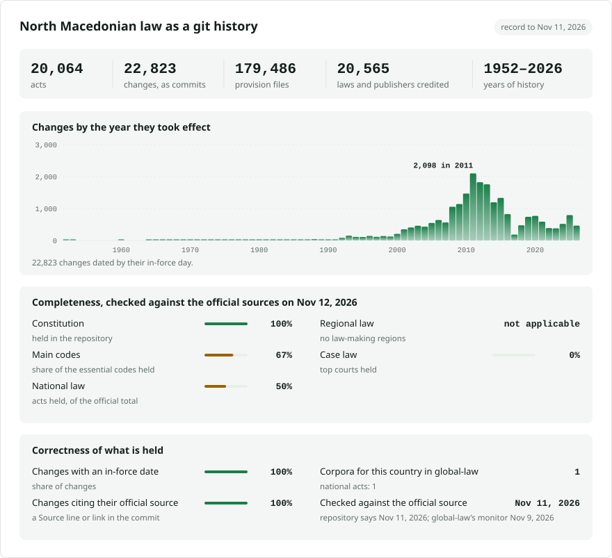

# North Macedonia: law history in git

**English** · **[Или прочитајте на македонски](README.md)**

<picture>
<source media="(prefers-color-scheme: dark)" srcset="data/effort-dark.svg">

</picture>

The law of North Macedonia as a git history: one file per article, one commit per version on the day it took effect, and the act that made each change as the commit's author. Службен весник prints no consolidated texts, so each act is here as enacted and its amending acts are acts of their own; the Constitution, with each of its 36 amendments applied to the article it names, and the Law on Personal Data Protection, with both amending laws, carry their changes. `git blame` names the act or amendment behind every paragraph; `git log` lists every change to an article; picking a date gives the text in force that day.

Part of [lexifina/global-law](https://github.com/lexifina/global-law), one git history for every country's law: this is North Macedonia's national law, which global-law reads at `north-macedonia/national/acts/`.

**What is in it now:** the Constitution (1991, through Amendments I-XXXVI), the Law on Personal Data Protection (2020, through both amending laws) and 20,062 acts from the Ministry of Justice's legal database (LDBIS), each as published in Службен весник from 1952 to 2026: 4,558 laws (3,248 of them amending laws), 6,881 rulebooks, 6,549 decisions, 1,058 Government decrees, 820 instructions, 89 orders, 63 rules of procedure, 31 collective agreements, 12 statutes and one declaration; 3,636 of them are marked no longer valid. [`ACTS.md`](ACTS.md) lists every act with its folder, status and span.

Each act is in `<kind>/<year>/sv<issue>-<id>/`, by the year and issue of Службен весник that published it and its LDBIS id, one file per article (`zakon/2005/sv062-10431/` is the Закон за работните односи, the Law on Labour Relations, Службен весник 62/2005, LDBIS id 10431); the Constitution is in `ustav/` (`clen-007.md` is Article 7). `data/paths.json` maps each act id to its folder.

The text is in Macedonian (Cyrillic), as Службен весник prints it. An English translation is not part of this record.

## Questions as git commands

| Question | Command |
| --- | --- |
| Every change to Article 7 of the Constitution | `git log -p --word-diff -- ustav/clen-007.md` |
| Which amendment wrote each line of Article 7? | `git blame ustav/clen-007.md` |
| Every version of the Constitution, with the day each took effect | `git log --format="%h %(trailers:key=In-force,valueonly,separator=) %an" -- ustav` |
| Article 7 as in force on 1 January 2000 | `python tools/on.py 2000-01-01 ustav clen-007` |

**Outside git**, we also host this record publicly, for free:

- **[Ask Claude about North Macedonian law](https://global-law.lexifina.com/v1/try_claude?country=north-macedonia)**: opens Claude with a first question ready.
- **[Ask ChatGPT](https://global-law.lexifina.com/v1/try_chatgpt?country=north-macedonia)**: the same question in ChatGPT.
- **[Search North Macedonian law on our site](https://lexifina.com/law?country=north-macedonia&q=%D0%B3%D0%BE%D0%B4%D0%B8%D1%88%D0%B5%D0%BD+%D0%BE%D0%B4%D0%BC%D0%BE%D1%80)**: a search for "годишен одмор", with each provision's text and its versions, no account needed.
- **[Developer REST API](https://global-law.lexifina.com/v1/search_law?query=%D0%B3%D0%BE%D0%B4%D0%B8%D1%88%D0%B5%D0%BD+%D0%BE%D0%B4%D0%BC%D0%BE%D1%80&jurisdiction=north-macedonia)**: the same search as JSON, with no key. See the [documentation here](https://lexifina.com/api/global-law).

Both assistants read the record through the free Global law connector (MCP, `https://global-law.lexifina.com/mcp`); the first time, the chat gives you the link that adds it. Ask in Macedonian or in English.

**Host it yourself easily.** All it takes is git and Python, and the tools run on your machine:

```sh
git clone --depth 1 https://github.com/lexifina/global-law && cd global-law
python3 tools/countries.py add north-macedonia/national/acts
python3 tools/law.py show 2026-01-01 north-macedonia/national/acts/ustav/clen-007.md
```

Opened in Claude Code, Cursor, VS Code or Codex, the clone also starts a local MCP server with the same tools ([MCP.md](https://github.com/lexifina/global-law/blob/main/MCP.md)).

## Dates

Each commit is dated at noon, Europe/Skopje, on the day the version took effect, and carries it in its `In-force:` trailer:

- for an act from LDBIS, the in-force day LDBIS records, checked against the act's own final article where that names a day (an act whose two days differ is held back); a law takes effect no earlier than the eighth day after its publication unless it sets an earlier day (Constitution, Article 52);
- for the Constitution and its amendments, the day each states;
- for an act LDBIS marks no longer valid, a last version with no text, on its end-of-validity day;
- git cannot store dates before 1970, so the 19 earlier commits are dated 1970-01-01, with the real day in `In-force:`. Ask for a date with `tools/on.py`, not `git log --before`.

Each act's text is credited to the act itself, as the Gazette cites it; each change to the Constitution to its amendment, and each to the Law on Personal Data Protection to its amending law. An end of validity is credited to the act that repealed it when that act's text names it, otherwise to Службен весник (678 commits).

## How it is checked

- `tools/build/check_repo.py` reads every version back from git on the day it took effect and on the day before and compares it with the corpus the history is built from; it also checks that every commit's trailers parse, that `main` has no merge commits and that nothing is dated in the future. [`REPRODUCE.md`](REPRODUCE.md) says how the history is built.
- Each act's text is its Gazette PDF's own text layer, split into articles by the page layout, with no OCR and no model; each amendment to the Constitution is applied by code to the provision its own instruction names.
- History is append-only: a text later found to read differently is corrected in a labelled commit (`Kind: correction`, 47 so far), and both versions are kept.

## What it does not show

- **Consolidated texts.** Службен весник prints none: 1,985 acts that later acts amended are here as enacted, marked `amended, not consolidated`, with the amending acts named in `data/acts.json` (`amended_by`).
- **Acts held back.** 9,191 acts LDBIS lists are not here yet; [`data/held.json`](data/held.json) gives the rule that holds each (no text layer or no text on LDBIS, a layout that does not split into articles, an in-force day the act contradicts, an end of validity LDBIS does not explain).
- **Promulgation decrees and signatures.** The Указ above each law and the signatures are left out; footnotes printed with an act are in its `zz-fusnoti.md`, not in an article.
- **Treaty texts.** The 423 ratification laws are here without the treaty text each prints.
- **Local acts, court decisions and bills** are not part of this repository.
- **Changes after 9 November 2026.** Every act here was last checked against LDBIS on that day ([`data/freshness.json`](data/freshness.json)).

## Sources

| Source | Kind | Past versions | Notes |
| --- | --- | --- | --- |
| [LDBIS](https://ldbis.pravda.gov.mk/) (Ministry of Justice) | Official legal database, with each act's Gazette PDF | no: each act as enacted, and its end of validity | Every act but the two below: Gazette issue, in-force and end-of-validity days, linked acts |
| [Службен весник](https://www.slvesnik.com.mk/) | Official Gazette | every issue since 1945 (PDF) | The Constitution's Amendments XIX-XXXVI and the Law on Personal Data Protection |
| [Собрание](https://www.sobranie.mk/) (Assembly) | Certified copy of the Constitution | the 1991 text and Amendments I-XXXII | The Constitution's 1991 text and Amendments I-XVIII |

## Licence

See [`LICENSE`](LICENSE). The texts are official texts of the Republic of North Macedonia, which the Law on Copyright and Related Rights (Закон за авторското право и сродните права) excludes from copyright protection; Lexifina's arrangement, commit messages, tables and tools are dedicated to the public domain under CC0 1.0.

No AI model wrote or changed legal text; the scripts were written by an AI model (see [`REPRODUCE.md`](REPRODUCE.md)).

## More

From [lexifina/global-law](https://github.com/lexifina/global-law):

- [FEATURES.md](https://github.com/lexifina/global-law/blob/main/FEATURES.md): every feature, and what every corpus must support (`git blame`, `law.py`, the MCP tools)
- [FAQ.md](https://github.com/lexifina/global-law/blob/main/FAQ.md): questions and answers · [CONTRIBUTING.md](https://github.com/lexifina/global-law/blob/main/CONTRIBUTING.md): proposing changes · [MCP.md](https://github.com/lexifina/global-law/blob/main/MCP.md): the MCP server · [REPRODUCE.md](https://github.com/lexifina/global-law/blob/main/REPRODUCE.md): how it was built · [CHANGELOG.md](https://github.com/lexifina/global-law/blob/main/CHANGELOG.md)
- [FRESHNESS.md](https://github.com/lexifina/global-law/blob/main/FRESHNESS.md): how current each corpus is · [Monitoring](https://github.com/lexifina/global-law/tree/main/monitoring): whether updates are running · [WATCHING.md](https://github.com/lexifina/global-law/blob/main/WATCHING.md): how each official source is watched for changes
- [performance/](https://github.com/lexifina/global-law/tree/main/performance): how fast the tools are, measured
- [visualisations/](https://github.com/lexifina/global-law/tree/main/visualisations): charts and bridges across the world's law
- [Vulnerabilities](https://github.com/lexifina/global-law/tree/main/vulnerabilities): mistakes in legislation as published
