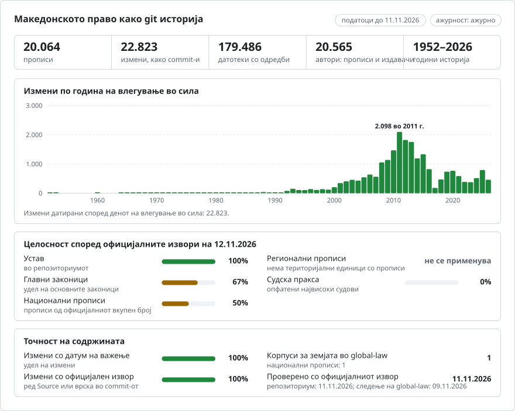

# Северна Македонија: историјата на правото во git

**Македонски** · [English](README.en.md)

<picture>
<source media="(prefers-color-scheme: dark)" srcset="data/mk/effort-dark.svg">

</picture>

Дел од [lexifina/global-law](https://github.com/lexifina/global-law), единствена историја во git за правото на сите држави: ова е националното право на Северна Македонија, кое global-law го чита во `north-macedonia/national/acts/`.

Правото на Северна Македонија како историја во git: по една датотека за секој член, по еден commit за секој пропис или измена на денот кога влегле во сила, а прописот што ја направил секоја промена е автор на commit-от. `git blame` го наведува прописот зад секој став; `git log` ги наведува сите измени на еден член; алатката подолу го дава текстот што важел на кој било ден. Текстовите се на македонски јазик (кирилица), службениот јазик.

**Што содржи.** Околу 13.500 прописи од правната база на податоци на Министерството за правда (LDBIS), секој како што е објавен во Службен весник: закони (`zakon/`), уредби на Владата (`uredba/`), правилници (`pravilnik/`), упатства (`upatstvo/`), наредби (`naredba/`), статути (`statut/`) и деловници (`delovnik/`), од 1952 година до денес, со престанокот на важење на прописите што LDBIS ги означува како неважечки. Два прописа имаат целосна историја на измените, изработена рачно: Уставот (`ustav/`, од 1991 година до Амандманите I-XXXVI) и Законот за заштита на личните податоци (`zakon-za-zastita-na-licnite-podatoci/`, од 2020 година до двата закона за негово изменување). [ACTS.md](ACTS.md) ги наведува сите прописи со нивната папка, статус и временски опфат.

## Структура

| Каде | Што |
| --- | --- |
| `<kind>/<year>/sv<issue>-<id>/` | еден пропис: `<kind>` како погоре, годината и бројот на Службен весник во кој е објавен и неговиот идентификатор во LDBIS (`zakon/2006/sv013-11057/` е Законот за даночна постапка, Службен весник 13/2006, идентификатор во LDBIS 11057) |
| `<act>/art-NNN.md` · `<act>/README.md` | по еден член во датотека (по еден став во ред) · верзиите на прописот, неговиот статус и официјалниот линк |
| `ustav/` | Уставот, по една датотека за секој член (`clen-NNN.md`) |
| [ACTS.md](ACTS.md) · `data/` · `tools/` | списокот на прописи · табели (`data/acts.json`, `data/versions.json`, `data/laws.csv`, `data/paths.json`) · алатките подолу |

## Користење

| Прашање | Команда |
| --- | --- |
| Што гласел членот 4 од Уставот на 1 јануари 2010? | `python tools/on.py 2010-01-01 ustav clen-004` |
| Член од пропис на одреден ден | `python tools/on.py 2015-06-01 zakon/2006/sv013-11057 art-062` |
| Кој амандман го напишал секој став од членот 3 од Уставот? | `git blame ustav/clen-003.md` |
| Секоја измена на член, збор по збор | `git log -p --word-diff ustav/clen-104.md` |
| Дали прописот овде е ажурен? | `python tools/freshness.py zakon/2006/sv013-11057` |
| Задржани прописи и зошто | `data/held.json` |
| Прописи што се објавени, но сè уште не се во сила | `data/pending.json` |

Датумите читајте ги со алатките, а не со `git rev-list --before`: тие ја избираат секоја верзија според полето `In-force:` во commit-от. По повторна изградба, освежете ги ознаките (tags) со `git fetch --force --tags`.

## Колку е ажурно

Секоја верзија ја наведува официјалната страница од која е прочитана (нејзиниот запис во LDBIS, `Source:` во commit-от; `portal` во `data/acts.json`), така што секој пропис може да се провери според неговиот извор.

<!-- freshness-summary -->
Проверено според официјалните извори: 2026-11-09; 100% од прописите проверени во последните 7 дена, 100% во последните 30 ([data/freshness.json](data/freshness.json)).
<!-- /freshness-summary -->

`python tools/freshness.py <act>` ги дава статусот на прописот, неговата последна проверка и официјалниот линк. Освежувањето се извршува секој ден: ги чита записите што LDBIS ги додал, повторно го чита записот на секој пропис овде (законите и уредбите на Владата во рок од 7 дена, другите прописи во рок од 30), додава нови прописи и верзии и повторно ги запишува датотеките за ажурност. [data/status.json](data/status.json) покажува дали ажурирањата работат и дали LDBIS одговара. По еден ред за секој пропис во `data/freshness/<kind>/<year>.csv`; статусите (`current`, `pending-change`, `stale`, `unverified`, `source-unavailable`) и полињата се објаснети во `data/freshness.json`.

## Датуми, автори и ограничувања

- Секој commit е датиран на денот кога промената влегла во сила; автор е прописот што ја направил (адреса што не може да постои, па `git log --author` ги наведува прописите), а committer е Lexifina. Денот на влегување во сила е оној што го евидентира LDBIS, проверен според последниот член на самиот пропис кога тој наведува ден; кога двата датума се разликуваат, прописот се задржува.
- Пропис што LDBIS го означува како неважечки добива последна верзија без текст, од денот на престанокот на важење, припишана на прописот што го укинал, кога текстот на тој пропис го наведува.
- **Нема службени пречистени текстови.** За речиси секој пропис Службен весник го објавува само прописот како што е донесен и секој пропис за негово изменување; нема службен пречистен текст што би можел да се прочита. Затоа пропис што подоцнежен пропис го изменил е објавен **во изворниот текст** и означен `amended, not consolidated`, со наведување на прописите за изменување и одлуките на Уставниот суд што LDBIS ги поврзува со него (`amended_by` во `data/acts.json`, со нивните официјални линкови); неговиот текст овде не ги вклучува тие измени. Пропис што подоцнежните прописи само го повикуваат е означен `cited later, not consolidated` (`cited_by`). Таквите прописи имаат статус `pending-change` во датотеките за ажурност.
- **Задржани** (наведени во `data/held.json` со правилото поради кое е задржан секој од нив): прописи чиј PDF во LDBIS нема текстуален слој или воопшто нема текст, чиј текст не може чисто да се подели на членови, чиј ден на влегување во сила не се совпаѓа со нивниот последен член, што ги наведува некоја Исправка или со кои LDBIS поврзува службен пречистен текст што сè уште не е изработен како верзија.
- Не се вклучени: указот за прогласување (Указ) над секој закон, потписите, ниту одлуките (Одлуки) и другите акти надвор од седумте видови наведени погоре. Фуснотите отпечатени со прописот се во неговата датотека `zz-fusnoti.md` и не се дел од член.
- Автентичен е само текстот објавен во Службен весник. Овој репозиториум е помагало за истражување, а не правен совет ниту службена публикација.

## Како се проверува

- Секоја верзија повторно се чита од git на денот кога влегла во сила и на претходниот ден (`tools/check_repo.py`) и мора да се совпаѓа со корпусот; на `main` нема merge commit-и, датумите на commit-ите никогаш не одат наназад, ништо не е датирано во иднина, а полињата (trailers) на секој commit се читаат исправно. Резултатите се во [REPRODUCE.md](REPRODUCE.md).
- Текстот на секој пропис е сопствениот текстуален слој на неговиот PDF од Службен весник, поделен на членови според распоредот на страницата (без OCR, без модел). За примерок од 220 прописи, повторно прочитани од LDBIS на 9 ноември 2026, LDBIS ги врати истите PDF-датотеки, идентични бајт по бајт.
- Додавањето е само надоврзување: објавен commit никогаш не се препишува. Текст за кој подоцна ќе се утврди дека гласи поинаку се исправа со означен commit за исправка (`Kind: correction`), при што се зачувуваат двете верзии.

## Извори

| Извор | Што дава | Употреба |
| --- | --- | --- |
| [LDBIS](https://ldbis.pravda.gov.mk/) (Министерство за правда) | записот за секој пропис: број на Службен весник, денови на објавување, влегување во сила, примена и престанок на важење, поврзани прописи; и PDF на прописот од Службен весник | Да: сите прописи освен двата подолу |
| [Службен весник](https://www.slvesnik.com.mk/) | секој број од 1945 година (PDF) | Амандманите XIX-XXXVI на Уставот и Законот за заштита на личните податоци |
| [Собрание](https://www.sobranie.mk/) | заверениот примерок на Уставот од 1991 година и Амандманите I-XXXII | Текстот на Уставот од 1991 година и Амандманите I-XVIII |

## Лиценца

Текстовите се службени текстови на Република Северна Македонија, кои Законот за авторското право и сродните права ги исклучува од авторскоправна заштита. Распоредот, табелите, пораките на commit-ите и алатките на Lexifina се ставени во јавен домен според CC0 1.0; видете [LICENSE](LICENSE). Ниту еден модел не напишал ниту изменил правен текст.

Ова е превод на англиската верзија ([README.en.md](README.en.md)); ако се разликуваат, важи англиската верзија.

## Повеќе

Од репозиториумот [lexifina/global-law](https://github.com/lexifina/global-law) (на англиски):

- [FEATURES.md](https://github.com/lexifina/global-law/blob/main/FEATURES.md): сите функции и што мора да поддржува секој корпус (`git blame`, `law.py`, MCP алатки)
- [FAQ.md](https://github.com/lexifina/global-law/blob/main/FAQ.md): прашања и одговори · [CONTRIBUTING.md](https://github.com/lexifina/global-law/blob/main/CONTRIBUTING.md): предлагање измени · [MCP.md](https://github.com/lexifina/global-law/blob/main/MCP.md): MCP сервер · [REPRODUCE.md](https://github.com/lexifina/global-law/blob/main/REPRODUCE.md): како е изработен · [CHANGELOG.md](https://github.com/lexifina/global-law/blob/main/CHANGELOG.md)
- [FRESHNESS.md](https://github.com/lexifina/global-law/blob/main/FRESHNESS.md): колку е ажурен секој корпус · [Следење](https://github.com/lexifina/global-law/tree/main/monitoring): дали ажурирањата работат · [WATCHING.md](https://github.com/lexifina/global-law/blob/main/WATCHING.md): како секој официјален извор се следи за измени
- [performance/](https://github.com/lexifina/global-law/tree/main/performance): колку се брзи алатките, измерено
- [visualisations/](https://github.com/lexifina/global-law/tree/main/visualisations): графикони и врски низ правото на целиот свет
- [Ранливости](https://github.com/lexifina/global-law/tree/main/vulnerabilities): грешки во прописите онака како што се објавени
