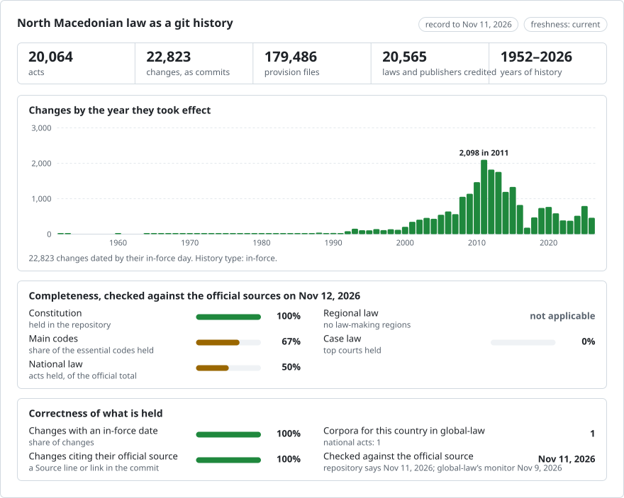

# North Macedonia: law history in git

<picture>
<source media="(prefers-color-scheme: dark)" srcset="data/effort-dark.svg">

</picture>

Part of [lexifina/global-law](https://github.com/lexifina/global-law), one git history for every country's law: this is North Macedonia's national law, which global-law reads at `north-macedonia/national/acts/`.

The law of North Macedonia as a git history: one file per article, one commit per act or amendment on the day it took effect, and the act that made each change as the commit's author. `git blame` names the act behind every paragraph; `git log` lists every change to an article; the tool below gives the text in force on any day. The texts are in Macedonian (Cyrillic), the official language.

*На македонски: [подолу](#македонски).*

**What is in it.** About 13,500 acts from the Ministry of Justice's legal database (LDBIS), each as published in Службен весник (the Official Gazette): laws (`zakon/`), Government decrees (`uredba/`), rulebooks (`pravilnik/`), instructions (`upatstvo/`), orders (`naredba/`), statutes (`statut/`) and rules of procedure (`delovnik/`), from 1952 to today, with the end of validity of the acts LDBIS marks no longer valid. Two acts have a full amendment history built by hand: the Constitution (`ustav/`, 1991 through Amendments I-XXXVI) and the Law on Personal Data Protection (`zakon-za-zastita-na-licnite-podatoci/`, 2020 through both amending laws). [ACTS.md](ACTS.md) lists every act with its folder, status and span.

## Layout

| Where | What |
| --- | --- |
| `<kind>/<year>/sv<issue>-<id>/` | one act: `<kind>` as above, the year and Gazette issue it was published in, and its LDBIS id (`zakon/2006/sv013-11057/` is the Law on Tax Procedure, Службен весник 13/2006, LDBIS id 11057) |
| `<act>/art-NNN.md` · `<act>/README.md` | one article per file (one paragraph per line) · the act's versions, status and official link |
| `ustav/` | the Constitution, one file per article (`clen-NNN.md`) |
| [ACTS.md](ACTS.md) · `data/` · `tools/` | the act list · tables (`data/acts.json`, `data/versions.json`, `data/laws.csv`, `data/paths.json`) · the tools below |

## Use it

| Question | Command |
| --- | --- |
| What did Article 4 of the Constitution say on 1 January 2010? | `python tools/on.py 2010-01-01 ustav clen-004` |
| An act's article on a day | `python tools/on.py 2015-06-01 zakon/2006/sv013-11057 art-062` |
| Which amendment wrote each paragraph of Article 3 of the Constitution? | `git blame ustav/clen-003.md` |
| Every change to an article, word by word | `git log -p --word-diff ustav/clen-104.md` |
| Is an act here current? | `python tools/freshness.py zakon/2006/sv013-11057` |
| Acts held back, and why | `data/held.json` |
| Acts published but not yet in force | `data/pending.json` |

Read dates with the tools, not `git rev-list --before`: they pick each version by its `In-force:` trailer. After a rebuild, refresh tags with `git fetch --force --tags`.

## How current is it

Every version names the official page it was read from (its LDBIS record, `Source:` in the commit; `portal` in `data/acts.json`), so every act can be checked against its source.

<!-- freshness-summary -->
Checked against the official sources: 2026-11-09; 100% of acts verified in the last 7 days, 100% in the last 30 ([data/freshness.json](data/freshness.json)).
<!-- /freshness-summary -->

`python tools/freshness.py <act>` gives an act's status, its last check and the official link. A refresh runs every day: it reads the records LDBIS has added, re-reads the record of every act here (laws and Government decrees within 7 days, other acts within 30), appends new acts and versions, and rewrites the freshness files. [data/status.json](data/status.json) says whether updates are running and whether LDBIS is answering. One row per act in `data/freshness/<kind>/<year>.csv`; statuses (`current`, `pending-change`, `stale`, `unverified`, `source-unavailable`) and fields are explained in `data/freshness.json`.

## Dates, authors and limits

- Each commit is dated on the day the change took effect; the author is the act that made it (an address that cannot exist, so `git log --author` names acts), the committer Lexifina. The in-force day is the one LDBIS records, checked against the act's own final article where that names a day; where the two differ, the act is held back.
- An act LDBIS marks no longer valid gets a last version with no text, from its end-of-validity day, credited to the act that repealed it when that act's text names it.
- **No official consolidated texts.** For almost every act the Official Gazette prints only the act as passed and each amending act; there is no official consolidated text to read. An act a later act amended is therefore published **as enacted** and marked `amended, not consolidated`, naming the amending acts and Constitutional Court decisions LDBIS links to it (`amended_by` in `data/acts.json`, with their official links); its text here does not include those amendments. An act later acts only cite is marked `cited later, not consolidated` (`cited_by`). Such acts are `pending-change` in the freshness files.
- **Held back** (listed in `data/held.json` with the rule that holds each): acts whose PDF has no text layer or no text at all on LDBIS, whose text does not split cleanly into articles, whose in-force day disagrees with their own final article, which a correction (Исправка) names, or to which LDBIS links an official consolidated text not yet built as a version.
- Not included: the promulgation decree (Указ) above each law, signatures, and decisions (Одлуки) and other acts outside the seven kinds above. Footnotes printed with an act are its `zz-fusnoti.md` file, not part of an article.
- Only the text published in Службен весник is authoritative. This repository is a research aid, not legal advice and not an official publication.

## How it is checked

- Every version is read back from git on the day it took effect and on the day before (`tools/check_repo.py`) and must match the corpus; no merge commits on `main`, commit dates never go backwards, nothing is dated in the future, and every commit's trailers parse. Results are in [REPRODUCE.md](REPRODUCE.md).
- The text of each act is its Gazette PDF's own text layer, split into articles by the layout (no OCR, no model). A sample of 220 acts re-read from LDBIS on 9 November 2026 served byte-identical PDFs.
- Additions are append-only: a published commit is never rewritten. A text found to read differently later is corrected in a labelled correction commit (`Kind: correction`), both versions kept.

## Sources

| Source | What it gives | Used |
| --- | --- | --- |
| [LDBIS](https://ldbis.pravda.gov.mk/) (Ministry of Justice) | each act's record: Gazette issue, publication, in-force, application and end-of-validity days, linked acts; and the act's Gazette PDF | Yes: every act except the two below |
| [Службен весник](https://www.slvesnik.com.mk/) (Official Gazette) | every issue since 1945 (PDF) | The Constitution's amendments XIX-XXXVI and the data protection law |
| [Собрание](https://www.sobranie.mk/) (Assembly) | the certified copy of the 1991 Constitution and Amendments I-XXXII | The Constitution's 1991 text and Amendments I-XVIII |

## Licence

The texts are official texts of the Republic of North Macedonia, which the Law on Copyright and Related Rights (Закон за авторското право и сродните права) excludes from copyright protection. Lexifina's arrangement, tables, commit messages and tools are dedicated to the public domain under CC0 1.0; see [LICENSE](LICENSE). No model wrote or changed legal text.

---

## Македонски

Правото на Република Северна Македонија како историја во git: една датотека по член, еден commit по пропис или измена, на денот кога влегле во сила, со прописот што ја направил промената како автор. Околу 13.500 прописи од базата LDBIS на Министерството за правда, секој како што е објавен во „Службен весник“: закони, уредби, правилници, упатства, наредби, статути и деловници. Пропис што подоцна е изменет, а за кој нема службен пречистен текст, е објавен во изворниот текст и означен „amended, not consolidated“, со измените што ги наведува LDBIS. Ова не е службено пречистен текст, ниту правен совет.
