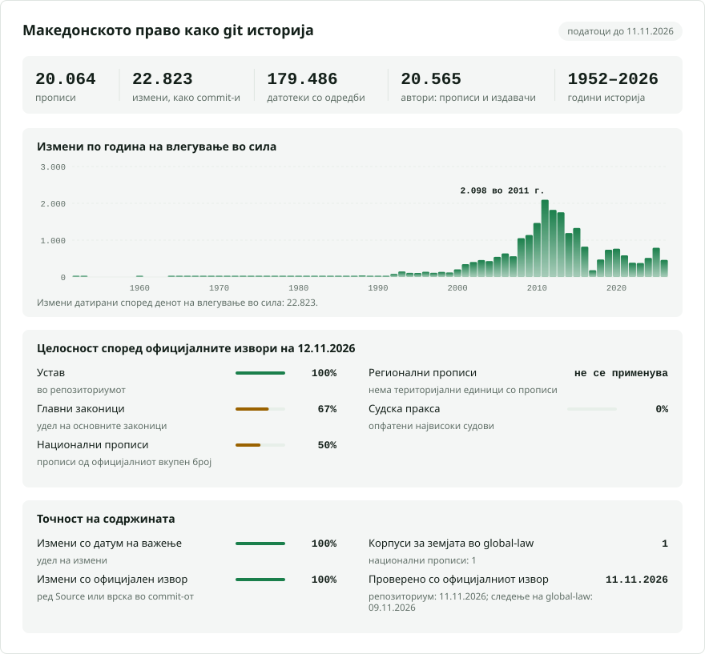

# Северна Македонија: историјата на правото во git

**Македонски** · **[Or read it in English](README.en.md)**

<picture>
<source media="(prefers-color-scheme: dark)" srcset="data/mk/effort-dark.svg">

</picture>

Правото на Северна Македонија како историја во git: по една датотека за секој член, по еден commit за секоја верзија на денот кога влегла во сила, а прописот што ја направил секоја промена е автор на commit-от. Службен весник не објавува пречистени текстови, па секој пропис е овде во изворниот текст, а прописите за негово изменување се посебни прописи; своите измени ги содржат Уставот, со секој од неговите 36 амандмани применет на членот што го наведува, и Законот за заштита на личните податоци, со двата закона за негово изменување. `git blame` го наведува прописот или амандманот зад секој став; `git log` ги наведува сите измени на еден член; со избор на датум се добива текстот што важел тој ден.

Дел од [lexifina/global-law](https://github.com/lexifina/global-law), единствена историја во git за правото на сите држави: ова е националното право на Северна Македонија, кое global-law го чита во `north-macedonia/national/acts/`.

**Што содржи сега:** Уставот (1991, до Амандманите I-XXXVI), Законот за заштита на личните податоци (2020, до двата закона за негово изменување) и 20.062 прописи од правната база на податоци на Министерството за правда (LDBIS), секој како што е објавен во Службен весник, од 1952 до 2026 година: 4.558 закони (од нив 3.248 закони за изменување), 6.881 правилник, 6.549 одлуки, 1.058 уредби на Владата, 820 упатства, 89 наредби, 63 деловници, 31 колективен договор, 12 статути и една декларација; 3.636 од нив се означени како неважечки. [`ACTS.md`](ACTS.md) ги наведува сите прописи со нивната папка, статус и временски опфат.

Секој пропис е во `<kind>/<year>/sv<issue>-<id>/`, според годината и бројот на Службен весник во кој е објавен и неговиот идентификатор во LDBIS, по една датотека за секој член (`zakon/2005/sv062-10431/` е Законот за работните односи, Службен весник 62/2005, идентификатор во LDBIS 10431); Уставот е во `ustav/` (`clen-007.md` е членот 7). `data/paths.json` го поврзува идентификаторот на секој пропис со неговата папка.

Текстот е на македонски јазик (кирилица), онака како што го објавува Службен весник. Превод на англиски јазик не е дел од овој запис.

## Прашања како git команди

| Прашање | Команда |
| --- | --- |
| Секоја измена на членот 7 од Уставот | `git log -p --word-diff -- ustav/clen-007.md` |
| Кој амандман го напишал секој ред од членот 7? | `git blame ustav/clen-007.md` |
| Секоја верзија на Уставот, со денот кога влегла во сила | `git log --format="%h %(trailers:key=In-force,valueonly,separator=) %an" -- ustav` |
| Членот 7 како што важел на 1 јануари 2000 | `python tools/on.py 2000-01-01 ustav clen-007` |

**Надвор од git** овој запис го објавуваме и јавно, бесплатно:

- **[Прашајте го Claude за правото на Северна Македонија](https://global-law.lexifina.com/v1/try_claude?country=north-macedonia)**: го отвора Claude со подготвено прво прашање.
- **[Прашајте го ChatGPT](https://global-law.lexifina.com/v1/try_chatgpt?country=north-macedonia)**: истото прашање во ChatGPT.
- **[Пребарувајте го правото на Северна Македонија на нашата страница](https://lexifina.com/law?country=north-macedonia&q=%D0%B3%D0%BE%D0%B4%D0%B8%D1%88%D0%B5%D0%BD+%D0%BE%D0%B4%D0%BC%D0%BE%D1%80)**: пребарување за „годишен одмор“, со текстот на секоја одредба и нејзините верзии, без сметка.
- **[REST API за програмери](https://global-law.lexifina.com/v1/search_law?query=%D0%B3%D0%BE%D0%B4%D0%B8%D1%88%D0%B5%D0%BD+%D0%BE%D0%B4%D0%BC%D0%BE%D1%80&jurisdiction=north-macedonia)**: истото пребарување како JSON, без клуч. Документацијата е [тука](https://lexifina.com/api/global-law).

Двата асистента го читаат записот преку бесплатниот конектор Global law (MCP, `https://global-law.lexifina.com/mcp`); првиот пат разговорот ви ја дава врската со која се додава. Прашајте на македонски или на англиски.

**Лесно поставете го сами.** Доволни се git и Python, а алатките работат на вашиот компјутер:

```sh
git clone --depth 1 https://github.com/lexifina/global-law && cd global-law
python3 tools/countries.py add north-macedonia/national/acts
python3 tools/law.py show 2026-01-01 north-macedonia/national/acts/ustav/clen-007.md
```

Отворен во Claude Code, Cursor, VS Code или Codex, клонот стартува и локален MCP сервер со истите алатки ([MCP.md](https://github.com/lexifina/global-law/blob/main/MCP.md)).

## Датуми

Секој commit е датиран напладне по скопско време (Europe/Skopje), на денот кога верзијата влегла во сила, а тој ден го носи и во полето `In-force:`:

- за пропис од LDBIS, денот на влегување во сила што го евидентира LDBIS, проверен според последниот член на самиот пропис кога тој наведува ден (пропис кај кој двата дена се разликуваат се задржува); законот влегува во сила најрано осмиот ден од објавувањето, освен ако не определи порано (Устав, член 52);
- за Уставот и неговите амандмани, денот што го наведува секој од нив;
- за пропис што LDBIS го означува како неважечки, последна верзија без текст, на денот на престанокот на важење;
- git не може да зачува датуми пред 1970 година, па 19-те постари commit-и се датирани 1970-01-01, а вистинскиот ден е во `In-force:`. Датумите барајте ги со `tools/on.py`, а не со `git log --before`.

Текстот на секој пропис е припишан на самиот пропис, како што го наведува Службен весник; секоја измена на Уставот на нејзиниот амандман, а секоја измена на Законот за заштита на личните податоци на законот за негово изменување. Престанокот на важење се припишува на прописот што го укинал, кога текстот на тој пропис го наведува, а во спротивно на Службен весник (678 commit-и).

## Како се проверува

- `tools/build/check_repo.py` ја чита секоја верзија од git на денот кога влегла во сила и на претходниот ден и ја споредува со корпусот од кој е изградена историјата; проверува и дали полињата (trailers) на секој commit се читаат исправно, дали на `main` нема merge commit-и и дали ништо не е датирано во иднина. [`REPRODUCE.md`](REPRODUCE.md) објаснува како е изградена историјата.
- Текстот на секој пропис е сопствениот текстуален слој на неговиот PDF од Службен весник, поделен на членови според распоредот на страницата, без OCR и без модел; секој амандман на Уставот е применет со код на одредбата што ја наведува неговата сопствена инструкција.
- Историјата само се надоврзува: текст за кој подоцна ќе се утврди дека гласи поинаку се исправа со означен commit (`Kind: correction`, досега 47), а се зачувуваат двете верзии.
- [vulnerabilities/](vulnerabilities/): можни грешки при изготвувањето на прописите на Северна Македонија, пронајдени со детекторите на global-law и рачно проверени.

## Што не прикажува

- **Пречистени текстови.** Службен весник не објавува такви: 1.985 прописи што подоцнежни прописи ги измениле се овде во изворниот текст, означени `amended, not consolidated`, со прописите за изменување наведени во `data/acts.json` (`amended_by`).
- **Задржани прописи.** 9.191 пропис што го наведува LDBIS сè уште не е тука; [`data/held.json`](data/held.json) го дава правилото поради кое е задржан секој од нив (нема текстуален слој или нема текст во LDBIS, распоред што не се дели на членови, ден на влегување во сила со кој самиот пропис не се согласува, престанок на важење што LDBIS не го објаснува).
- **Указите за прогласување и потписите.** Указот над секој закон и потписите се изоставени; фуснотите отпечатени со прописот се во неговата датотека `zz-fusnoti.md`, а не во член.
- **Текстовите на меѓународните договори.** 423-те закона за ратификација се тука без текстот на договорот што секој од нив го објавува.
- **Локалните прописи, судските одлуки и предлозите на закони** не се дел од овој репозиториум.
- **Измени по 9 ноември 2026.** Секој пропис овде последен пат е проверен според LDBIS на тој ден ([`data/freshness.json`](data/freshness.json)).

## Извори

| Извор | Вид | Претходни верзии | Белешки |
| --- | --- | --- | --- |
| [LDBIS](https://ldbis.pravda.gov.mk/) (Министерство за правда) | Службена правна база на податоци, со PDF на секој пропис од Службен весник | не: секој пропис во изворниот текст и неговиот престанок на важење | Сите прописи освен двата подолу: број на Службен весник, денови на влегување во сила и престанок на важење, поврзани прописи |
| [Службен весник](https://www.slvesnik.com.mk/) | Службено гласило | секој број од 1945 година (PDF) | Амандманите XIX-XXXVI на Уставот и Законот за заштита на личните податоци |
| [Собрание](https://www.sobranie.mk/) | Заверен примерок на Уставот | текстот од 1991 година и Амандманите I-XXXII | Текстот на Уставот од 1991 година и Амандманите I-XVIII |

## Лиценца

Видете [`LICENSE`](LICENSE). Текстовите се службени текстови на Република Северна Македонија, кои Законот за авторското право и сродните права ги исклучува од авторскоправна заштита; распоредот, пораките на commit-ите, табелите и алатките на Lexifina се ставени во јавен домен според CC0 1.0.

Ниту еден AI модел не напишал ниту изменил правен текст; скриптите ги напишал AI модел (видете [`REPRODUCE.md`](REPRODUCE.md)).

Ова е превод на англиската верзија ([README.en.md](README.en.md)); ако се разликуваат, важи англиската верзија.

## Визуелизации

- [visualisations/](visualisations/): графикони нацртани од ова складиште. Сè уште не се нацртани.

## Повеќе

Од репозиториумот [lexifina/global-law](https://github.com/lexifina/global-law) (на англиски):

- [FEATURES.md](https://github.com/lexifina/global-law/blob/main/FEATURES.md): сите функции и што мора да поддржува секој корпус (`git blame`, `law.py`, MCP алатки)
- [FAQ.md](https://github.com/lexifina/global-law/blob/main/FAQ.md): прашања и одговори · [CONTRIBUTING.md](https://github.com/lexifina/global-law/blob/main/CONTRIBUTING.md): предлагање измени · [MCP.md](https://github.com/lexifina/global-law/blob/main/MCP.md): MCP сервер · [REPRODUCE.md](https://github.com/lexifina/global-law/blob/main/REPRODUCE.md): како е изработен · [CHANGELOG.md](https://github.com/lexifina/global-law/blob/main/CHANGELOG.md)
- [FRESHNESS.md](https://github.com/lexifina/global-law/blob/main/FRESHNESS.md): колку е ажурен секој корпус · [Следење](https://github.com/lexifina/global-law/tree/main/monitoring): дали ажурирањата работат · [WATCHING.md](https://github.com/lexifina/global-law/blob/main/WATCHING.md): како секој официјален извор се следи за измени
- [performance/](https://github.com/lexifina/global-law/tree/main/performance): колку се брзи алатките, измерено
- [visualisations/](https://github.com/lexifina/global-law/tree/main/visualisations): графикони и врски низ правото на целиот свет
- [Ранливости](https://github.com/lexifina/global-law/tree/main/vulnerabilities): грешки во прописите онака како што се објавени
