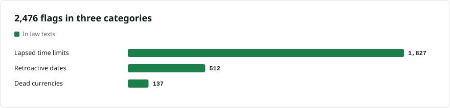

# Vulnerabilities in North Macedonian law

[Македонски](README.md) · **English**

<picture>
<source media="(prefers-color-scheme: dark)" srcset="img/flags-by-category-dark.svg">

</picture>

The vulnerability detectors from [lexifina/global-law](https://github.com/lexifina/global-law/tree/main/vulnerabilities) look for mechanical mistakes in legislation: a rule applying "until" a date that has passed, a time limit extended only after it had run out, two amendments to the same act on the same day, an act in force before it was published. global-law's published list (9 November 2026) covered North Macedonia with 30 flags, all of them the Constitution of 1991 and 29 of its amendments, in force on the day the Assembly proclaimed them and published days later, from an earlier copy of this repository. So this is a run over this repository only, as it stood at commit [`0a66523`](https://github.com/lexifina/north-macedonia-law/commit/0a6652300aa2873fc998e77d60ea48bb38cb2157) on 15 November 2026, with the Constitution, the Law on Personal Data Protection and the 20,062 acts from the Ministry of Justice's legal database (LDBIS) it now holds.

**In short:** the detectors raised 2,476 flags. A language model reviewed 80 of the strongest, arguing each one for and against; 15 survived. Checked by hand in this repository, none is a confirmed drafting mistake, but five stand for a question that reaches hundreds of acts. Five decisions that set general rules (the Phare fund's interest subsidies of 1998, the pay coefficients of two posts fixed by an Assembly commission in 2006, the Government's pay groups for posts of the Public Revenue Office in 1994, a limit on pension funds' investments of 2006 and the electronic communications markets subject to regulation of 2010) take effect on the day they were adopted, by their own words, and were published 19 to 38 days later, while Article 52 of the Constitution has laws and other regulations published before they take effect and within seven days of their adoption; 695 acts in this repository take effect on their adoption day. Six are individual or organisational decisions (diplomatic relations with Vietnam, two state awards, a company of special importance, two coordinating bodies), for which publication is notice, and four are time limits that have run their course. Later, this will be formalised in Lean, similar to our work on [the US tax code](https://lexifina.com/blog/formalizing-the-us-tax-code) and [US case law](https://lexifina.com/blog/formalizing-all-us-case-law-in-lean).

A flag is a prompt to look, not legal advice, and nothing here has been tested in court.

## Flags by category

| Category | What it looks for | Flags | In law texts | Reviewed | Survived review |
| --- | --- | ---: | ---: | ---: | ---: |
| Lapsed time limits | Text still applying a rule "until" a date that has passed | 1,827 | 1,827 | 40 | 4 |
| Retroactive or pre-publication dates | An act in force before it was made or published | 512 | 512 | 40 | 11 |
| Dead currencies | Amounts in currencies no longer in use | 137 | 137 | 0 | 0 |

"In law texts" counts every act held here: the Constitution, laws, Government decrees, rulebooks, decisions, orders, instructions, statutes, rules of procedure, collective agreements and a declaration; only this repository's documentation (`data/`, `tools/`, the root files and each act's `README.md`) is counted as not law, and it has no flags. The search for same-day conflicts, repeal gaps, empty periods, stale amounts, references to deleted provisions and repealed placeholders, dead fines, duplicate numbering and publisher notes found nothing: the Службен весник publishes no consolidated texts, so apart from the Constitution and the Law on Personal Data Protection every act is held in one version, as published, and an amending act is an act of its own whose instructions are not applied; the two histories this repository does carry have nothing for those detectors to flag. The lapsed-limit detector reads "до" ("until"), "заклучно со" ("up to and including") and "најдоцна до" ("at the latest by") before a day, a month in words or digits and a year, and "до крајот на" ("until the end of") before a year: all 1,885 such phrases in law texts are read. The 90 that give only a month and a year ("до април 2020 година", "заклучно со месец јули 2019") are not. "По" before a date, which in Macedonian means "after", no longer starts a time limit.

*Edge cases: the 15 flags that survived the review, grouped by what they turned out to be, and what the other flags are, in [EDGE-CASES.en.md](EDGE-CASES.en.md).*

## Problems found in this repository

- **Quotation marks read as letters:** in 1,742 acts (3,927 files), most of them from 1993 to 2005, the opening and closing quotation marks of the Gazette's text layer came out as the letters "С" and "м", so that („Службен весник на Република Македонија") reads "(ССлужбен весник на Република Македонијам" (7,543 times; for example the [preamble of the Phare fund's decision of 1998](https://github.com/lexifina/north-macedonia-law/blob/0a6652300aa2873fc998e77d60ea48bb38cb2157/odluka/1998/sv042-5033/uvod.md)). A search for the Gazette's name or for a quoted word misses these texts.
- **Lines of the printed page:** `LICENSE` says each version holds one paragraph or alinea per line, but in 102 acts sentences run over several lines as they were printed, with 435 words split at a hyphen between two lines ("спро-" and "ведените" in Article 5 of the [2010 decision on relevant markets](https://github.com/lexifina/north-macedonia-law/blob/0a6652300aa2873fc998e77d60ea48bb38cb2157/odluka/2010/sv133-20396/art-005.md)); in others a hyphen of the printed line stays inside the word ("1 февру-ари 2006").

## Files

| File | What it holds |
| --- | --- |
| [data/flags.csv](data/flags.csv) | Every flag, one row per provision or act and issue |
| [data/reviewed.csv](data/reviewed.csv) | The 80 flags the model reviewed, with its verdict and reason |
| [data/by_category.csv](data/by_category.csv) | The counts in the table above |
| [tools/](tools/) | The scripts that made this run |

Columns: `category` and `category_mk` (the category in English and Macedonian), `detector`, `kind` (`law` or `other`), `path` (the file in this repository; for a retroactive date, the first file of the act), `date` (the date the flag turns on), `reference` (the act or line involved), `summary`, `score` (the detector's ranking, 0 to 1), `review` (`artefact`, `lawful` or `candidate_defect`), `survives_rebuttal`, `review_note` (the model's reason, in English), `url` (the file at the commit that was read, or, for a date flag, the commit that added the act on that day).

## How it was made

- **Detectors:** global-law's [vulnerabilities/scripts](https://github.com/lexifina/global-law/tree/main/vulnerabilities/scripts), run on this repository at commit `0a66523`. The history table the detectors read was built from this repository's own commits (the act that made each change, and the `In-force` and `Kind` trailers), counting the `law`, `decree`, `publisher` and `court` commits as changes to the law; the `correction` commits, which change only the act a change is credited to, are not. Fixes made for this repository read the Macedonian month names "јануари", "мај", "јуни" and "јули" (the other eight are spelled as in Bulgarian), "до крајот на" before a year, "заклучно со" before a date and "најдоцна" as a deadline, read the `clen-N` files of the Constitution and the data protection law as articles, and count amounts in dinars and in Deutsche Marks written in Cyrillic as dead currencies. A second run left out "по" before a date ("after"), which had raised 90 flags.
- **Model review:** gpt-5.4-mini, the 40 strongest flags per category, and for lapsed time limits also the 40 strongest in law texts (here the same 40); one pass says whether a flag is real, a second argues that it is not. After the second run the model reviewed the three flags that had taken the place, among the strongest, of three "по" flags; none survived. The model does not review dead currencies. The detectors found no empty periods, so global-law's review of that category had nothing to read. global-law's own list used a different model.
- **Hand check:** every case that survived was read in this repository's texts and history, against Article 52 of the Constitution as this repository holds it. Where an act's preamble gives no adoption day, the day is the one LDBIS records; the Службен весник's own page should confirm it. The counts of "до" phrases above are of the phrases on one line of a law text, at this commit (`tools/mk_gap_check.py`).

To report a correction, open an issue with the provision and an official source.

## Licence

The lists and notes are Lexifina's, dedicated to the public domain under CC0 1.0, like the rest of this repository's own contributions. Quoted text of acts is as the Службен весник на Република Северна Македонија publishes it; laws, other regulations and official acts are not protected by copyright under the Закон за авторското право и сродните права. See [LICENSE](../LICENSE).
