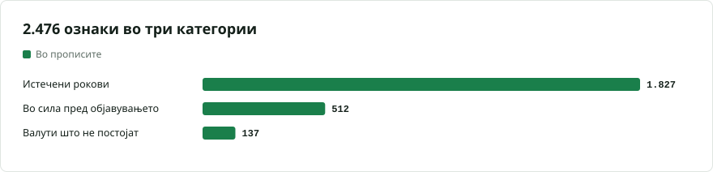

# Ранливости во правото на Северна Македонија

**Македонски** · [English](README.en.md)

<picture>
<source media="(prefers-color-scheme: dark)" srcset="img/flags-by-category-dark.mk.svg">

</picture>

Детекторите за ранливости од репозиториумот [lexifina/global-law](https://github.com/lexifina/global-law/tree/main/vulnerabilities) бараат механички грешки во прописите: правило што сè уште се применува „до“ датум што поминал, рок продолжен дури откако истекол, две измени на ист пропис на ист ден, пропис што е во сила пред да биде објавен. Листата што global-law ја објави на 9 ноември 2026 година ја опфаќаше Северна Македонија со 30 ознаки, сите за Уставот од 1991 година и 29 негови амандмани, кои влегле во сила на денот кога Собранието ги прогласило, а се објавени неколку дена подоцна, според порана копија на овој репозиториум. Затоа ова е проверка само на овој репозиториум, во состојбата на commit [`0a66523`](https://github.com/lexifina/north-macedonia-law/commit/0a6652300aa2873fc998e77d60ea48bb38cb2157) од 15 ноември 2026 година, со Уставот, Законот за заштита на личните податоци и 20.062 прописи од правната база на податоци на Министерството за правда (LDBIS) што сега ги содржи.

**Накратко:** детекторите дадоа 2.476 ознаки. Јазичен модел прегледа 80 од најсилните и за секоја изнесе аргументи за и против; 15 го издржаа прегледот. По рачната проверка во овој репозиториум ниедна не е потврдена грешка при изготвувањето на прописите, но пет отвораат прашање што се однесува на стотици прописи. Пет одлуки што утврдуваат општи правила (регресирањето на каматата од Компензациониот фонд Phare од 1998 година, коефициентите за плата на две функции што ги утврдила комисија на Собранието во 2006 година, платните групи на Владата за работни места во Управата за јавни приходи од 1994 година, ограничувањето на вложувањата на пензиските фондови од 2006 година и пазарите на електронски комуникации подложни на регулација од 2010 година) според сопствената одредба влегуваат во сила со денот на донесувањето, а се објавени 19 до 38 дена подоцна, додека членот 52 од Уставот определува законите и другите прописи да се објавуваат пред да влезат во сила и најдоцна седум дена од денот на нивното донесување; во овој репозиториум 695 прописи влегуваат во сила со денот на донесувањето. Шест се поединечни или организациски одлуки (воспоставување дипломатски односи со Виетнам, две државни награди, едно трговско друштво од особено значење, две координативни тела), за кои објавувањето служи за известување, а четири се рокови што истекле како што било предвидено. Подоцна ова ќе биде формализирано во Lean, слично на нашата работа на [даночниот законик на САД](https://lexifina.com/blog/formalizing-the-us-tax-code) и [судската пракса на САД](https://lexifina.com/blog/formalizing-all-us-case-law-in-lean).

Ознаката е повод да се погледне, а не правен совет, и ништо од ова не е проверено пред суд.

## Ознаки по категории

| Категорија | Што бара | Ознаки | Во прописите | Прегледани | Го издржаа прегледот |
| --- | --- | ---: | ---: | ---: | ---: |
| Истечени рокови | Текст што сè уште применува правило „до“ датум што поминал | 1.827 | 1.827 | 40 | 4 |
| Влегување во сила пред објавувањето | Пропис што е во сила пред да биде донесен или објавен | 512 | 512 | 40 | 11 |
| Валути што повеќе не постојат | Износи во валути што повеќе не се користат | 137 | 137 | 0 | 0 |

„Во прописите“ ги опфаќа сите прописи што се тука: Уставот, законите, уредбите на Владата, правилниците, одлуките, наредбите, упатствата, статутите, деловниците, колективните договори и една декларација; како документација, а не како право, се сметаат само `data/`, `tools/`, датотеките во коренот на репозиториумот и `README.md` на секој пропис, и во нив нема ознаки. Барањето измени на ист ден, празнини по укинувањето, празни периоди, застарени износи, упатувања на укинати и избришани одредби, глоби без опис на прекршокот, двојно нумерирање и белешки на издавачот не најде ништо: Службен весник не објавува пречистени текстови, па освен Уставот и Законот за заштита на личните податоци секој пропис е тука во една верзија, онака како што е објавен, а прописот за изменување е посебен пропис чии одредби за изменување не се применети; двете истории што репозиториумот ги содржи немаат ништо што тие детектори би го означиле. Детекторот за истечени рокови ги чита „до“, „заклучно со“ и „најдоцна до“ пред ден, месец (со зборови или со бројки) и година, како и „до крајот на“ пред година: прочитани се сите 1.885 такви изрази во прописите. Не се читаат 90-те изрази што наведуваат само месец и година („до април 2020 година“, „заклучно со месец јули 2019“). „По“ пред датум, што на македонски значи „после“, веќе не се чита како почеток на рок.

*Гранични случаи: 15-те ознаки што го издржаа прегледот, групирани според тоа што се покажаа, и што се останатите ознаки, во [EDGE-CASES.md](EDGE-CASES.md).*

## Проблеми пронајдени во овој репозиториум

- **Наводници прочитани како букви:** во 1.742 прописи (3.927 датотеки), повеќето од 1993 до 2005 година, отворените и затворените наводници од текстуалниот слој на Службен весник се прочитани како буквите „С“ и „м“, па („Службен весник на Република Македонија“) гласи „(ССлужбен весник на Република Македонијам“ (7.543 пати; на пример во [воведот на одлуката на фондот Phare од 1998 година](https://github.com/lexifina/north-macedonia-law/blob/0a6652300aa2873fc998e77d60ea48bb38cb2157/odluka/1998/sv042-5033/uvod.md)). Пребарувањето по името на Службен весник или по збор во наводници не ги наоѓа овие текстови.
- **Редови од печатената страница:** `LICENSE` наведува дека секоја верзија содржи по еден став или алинеја во ред, но во 102 прописи реченицата продолжува низ повеќе редови, онака како што е отпечатена, а 435 зборови се поделени со цртичка меѓу два реда („спро-“ и „ведените“ во членот 5 од [одлуката за релевантните пазари од 2010 година](https://github.com/lexifina/north-macedonia-law/blob/0a6652300aa2873fc998e77d60ea48bb38cb2157/odluka/2010/sv133-20396/art-005.md)); во други прописи цртичката од печатениот ред останала во зборот („1 февру-ари 2006“).

## Датотеки

| Датотека | Што содржи |
| --- | --- |
| [data/flags.csv](data/flags.csv) | Сите ознаки, по еден ред за одредба или пропис и проблем |
| [data/reviewed.csv](data/reviewed.csv) | 80-те ознаки што ги прегледа моделот, со неговата оценка и образложение |
| [data/by_category.csv](data/by_category.csv) | Броевите од табелата погоре |
| [tools/](tools/) | Скриптите со кои е направена проверката |

Колони: `category` и `category_mk` (категоријата на англиски и на македонски), `detector`, `kind` (`law` или `other`), `path` (датотеката во овој репозиториум; кај влегувањето во сила пред објавувањето, првата датотека на прописот), `date` (датумот на кој се однесува ознаката), `reference` (засегнатиот пропис или ред), `summary`, `score` (рангирањето на детекторот, од 0 до 1), `review` (`artefact`, `lawful` или `candidate_defect`), `survives_rebuttal`, `review_note` (образложението на моделот, на англиски), `url` (датотеката во прочитаниот commit, или, кај ознаките за датум, commit-от што го додал прописот на тој ден).

## Како е направено

- **Детектори:** [vulnerabilities/scripts](https://github.com/lexifina/global-law/tree/main/vulnerabilities/scripts) од global-law, пуштени врз овој репозиториум во commit `0a66523`. Табелата со историјата што ја читаат детекторите е изградена од сопствените commit-и на репозиториумот (прописот што ја направил секоја промена и полињата `In-force` и `Kind`), при што commit-ите од видовите `law`, `decree`, `publisher` и `court` се сметаат за промени на правото, а commit-ите `correction`, кои го менуваат само прописот на кој му е припишана промената, не се сметаат. Со поправките направени за овој репозиториум се читаат македонските имиња на месеците „јануари“, „мај“, „јуни“ и „јули“ (другите осум се пишуваат како на бугарски), „до крајот на“ пред година, „заклучно со“ пред датум и „најдоцна“ како краен рок, датотеките `clen-N` на Уставот и на Законот за заштита на личните податоци се читаат како членови, а износите во динари и во германски марки напишани на кирилица се бројат како валути што повеќе не постојат. Второто пуштање го изостави „по“ пред датум („после“), кое дало 90 ознаки.
- **Преглед со модел:** gpt-5.4-mini, 40-те најсилни ознаки во секоја категорија, а кај истечените рокови и 40-те најсилни во прописите (тука истите 40); првиот чекор оценува дали ознаката е вистинска, а вториот докажува дека не е. По второто пуштање моделот ги прегледа трите ознаки што меѓу најсилните го зазедоа местото на три ознаки со „по“; ниедна не го издржа прегледот. Моделот не ги прегледува валутите. Детекторите не најдоа празни периоди, па прегледот на global-law за таа категорија немаше што да прочита. Сопствената листа на global-law користела друг модел.
- **Рачна проверка:** секој случај што го издржа прегледот е прочитан во текстовите и историјата на овој репозиториум, во однос на членот 52 од Уставот онака како што е тука. Кога воведот на прописот не го наведува денот на донесувањето, тоа е денот што го евидентира LDBIS; треба да се потврди на страницата на самиот Службен весник. Броевите на изразите со „до“ погоре се однесуваат на изразите во еден ред од текстот на пропис, во овој commit (`tools/mk_gap_check.py`).

За да пријавите исправка, отворете issue со одредбата и службен извор.

## Лиценца

Листите и белешките се на Lexifina и се ставени во јавен домен според CC0 1.0, како и другите сопствени придонеси на овој репозиториум. Цитираниот текст на прописите е онаков каков што го објавува Службен весник на Република Северна Македонија; законите, другите прописи и службените акти не се заштитени со авторско право според Законот за авторското право и сродните права. Видете [LICENSE](../LICENSE).
